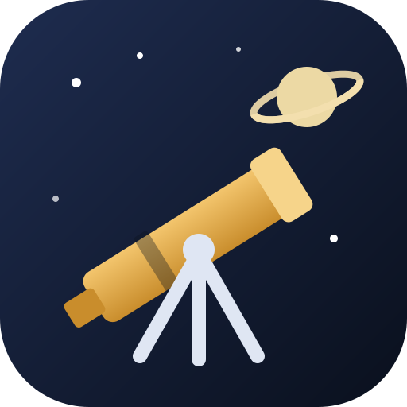

# Xưởng kính thiên văn – học thiên văn và tự chế kính thiên văn cho người Việt

Ứng dụng web cài được lên điện thoại (PWA), chạy cả khi không có mạng. Bắt đầu từ con số không: hiểu kính thiên văn làm gì, tự thiết kế và chế tạo chiếc kính của mình, rồi xem đêm nay có gì trên trời. Thuộc hệ sinh thái **[hlvsuckhoe.com](https://hlvsuckhoe.com/)**.

**👉 Mở ứng dụng: https://thienvan.hlvsuckhoe.com/** (dự phòng: https://nddzungx.github.io/xuong-kinh-thien-van/)

Mở link trên điện thoại → iPhone: Safari → Chia sẻ → *Thêm vào MH chính* · Android: Chrome → *Cài đặt ứng dụng*.

## Tính năng chính
- **Học (7 tab theo trình tự):** 4 thẻ kiến thức nền, sơ đồ linh kiện bấm được, **14 bài học** 3 cấp có câu chuyện lịch sử, máy tính thực hành và 5 câu trắc nghiệm (đáp án xáo trộn).
- **Thiết kế:** kính khúc xạ, Newton/Dobson, Schmidt-Cassegrain; khẩu độ, tỷ số f, giá đỡ, thị kính, phụ kiện. Thông số quang học, bản vẽ tỉ lệ, đường đi ánh sáng, **chi phí tự chế và mua sẵn (giá tham khảo)**, **so sánh 3 cấu hình**.
- **Chế tạo:** hướng dẫn chi tiết 8 giai đoạn cho **cả ba loại kính**, danh sách vật tư và nơi mua (tải CSV), bản vẽ cắt gỗ, máy tính mài gương và thử Foucault, mô phỏng chỉnh quang.
- **Quan sát thử:** Mặt Trăng, Mặt Trời (khi có màng lọc), Kim, Hỏa, Mộc, Thổ, Thiên Vương tinh qua kính bạn chọn; kích thước, pha, vệ tinh Mộc tinh và độ nghiêng vành Sao Thổ **theo ngày thật**.
- **Bầu trời đêm nay:** theo vị trí (10 địa điểm Việt Nam hoặc định vị), bản đồ vòm trời, thử thách quan sát, **dự báo nhật nguyệt thực, xung đối, mưa sao băng 1–3 năm tới**.
- **Hệ Mặt Trời:** quỹ đạo elip theo ngày thật, pha và bóng Mặt Trăng, đứng trên Mặt Trăng nhìn Trái Đất, vì sao có các mùa, thẻ thông tin thiên thể.
- **Nhật ký quan sát:** ghi buổi quan sát kèm hình phác họa, tìm kiếm, sao lưu CSV/JSON.
- **Đèn đỏ** giữ mắt quen bóng tối ngoài trời; giao diện sáng/tối theo máy. **Không quảng cáo, không thu thập dữ liệu.**

## Dành cho người phát triển: đưa lên GitHub Pages
1. Đăng nhập GitHub → **New repository** → tên `xuong-kinh-thien-van` → **Public** → **Create repository**.
2. **Add file → Upload files** → kéo **toàn bộ nội dung** thư mục này vào (gồm `index.html`, `sw.js`, `manifest.webmanifest`, `README.md`, `LICENSE`, `.nojekyll` và các thư mục `js/`, `img/`, `icons/`, `docs/`, `tools/`, `dist/`) → **Commit changes**.
   - Tệp `.nojekyll` bị ẩn trên Windows/macOS. Nếu không kéo được, tạo tệp mới tên `.nojekyll` (để trống) ngay trên GitHub.
3. **Settings → Pages** → *Source*: **Deploy from a branch** → Branch **main**, thư mục **/(root)** → **Save**. Sau 1–2 phút ứng dụng chạy tại `https://nddzungx.github.io/xuong-kinh-thien-van/`.
4. Tên miền riêng: tạo bản ghi DNS **CNAME** `thienvan` → `nddzungx.github.io`, rồi **Settings → Pages → Custom domain** nhập `thienvan.hlvsuckhoe.com` → **Save** → khi kiểm tra xong, bật **Enforce HTTPS**.

Chi tiết từng bước, cách cập nhật phiên bản và cách sửa trang chủ: xem **[docs/HUONG-DAN-CAP-NHAT.md](docs/HUONG-DAN-CAP-NHAT.md)**. Bàn giao kỹ thuật và kinh nghiệm: **[docs/BAN-GIAO.md](docs/BAN-GIAO.md)**.

**Cập nhật phiên bản mới:** sửa `index.html` / `js/app.js` → chạy `python tools/build.py` → tải đè các tệp lên repo. Người dùng mở app khi có mạng, đóng hẳn rồi mở lại là nhận bản mới.

## Cấu trúc mã
| Tệp | Vai trò |
|---|---|
| `index.html` | Khung trang, toàn bộ giao diện và CSS, 7 tab + trang Giới thiệu |
| `js/app.js` | Toàn bộ logic: quang học, chi phí, bản vẽ, thiên văn, dự báo, bài học, nhật ký, giới thiệu |
| `img/logo.svg`, `icons/` | Logo và biểu tượng cài đặt |
| `img/qr_ung_ho.png` | Mã VietQR mời cà phê (dùng chung với HLV Sức Khỏe) |
| `sw.js`, `manifest.webmanifest` | Chạy offline và cài như app (`sw.js` do `tools/build.py` tạo) |
| `tools/build.py` | Tạo lại `sw.js` và bản một tệp `dist/xuong-kinh-thien-van-offline.html` |
| `docs/` | Bàn giao, hướng dẫn cập nhật, danh sách tính năng chờ |

## Liên hệ – góp ý
📧 **nddzungx@gmail.com** · Báo lỗi trên GitHub: https://github.com/nddzungx/xuong-kinh-thien-van/issues

## Ủng hộ
Nếu thấy hữu ích, bạn có thể mời người phát triển một ly cà phê trong mục **Giới thiệu** của ứng dụng:
- Trong nước: VietQR – BIDV · 3210256468 · NGUYEN DUC DUNG
- Nước ngoài: PayPal – ndd.phateco@gmail.com

## An toàn và miễn trừ trách nhiệm
Nội dung mang tính giáo dục; vị trí, ngày giờ, kích thước và giá là ước tính. **Không bao giờ nhìn Mặt Trời** khi không có màng lọc đạt chuẩn ISO 12312-2 gắn chắc phía trước ống kính. Đeo đồ bảo hộ khi cắt gỗ, gia công kim loại, mài kính.

## Phiên bản
- **1.9.1** (22/11/2026): hướng dẫn cài lên điện thoại chi tiết (nút trong Giới thiệu và chân trang, mở thẳng bằng `thienvan.hlvsuckhoe.com/#cai-dat`); liên kết Tôi & Gia Đình. Tệp mới `js/install-guide.js` (đã thêm vào `tools/build.py`).
- **1.9.0** (21/11/2026): đưa lên GitHub Pages, cài được và chạy offline; trang Giới thiệu, mời cà phê (VietQR, PayPal), chia sẻ, liên hệ, cách dùng nhanh; dùng vị trí thiết bị; liên kết với hlvsuckhoe.com.
- **1.8** (03/11/2026): hướng dẫn chế tạo chi tiết cho cả ba loại kính, vật tư và nơi mua, so sánh 3 cấu hình, dự báo hiện tượng, nhật ký quan sát.
- **1.7** (02/11/2026): sửa bảng chi phí trống, bố cục 6 bước, xáo trộn đáp án, Mặt Trăng chính xác hơn, quan sát theo ngày thật, đèn đỏ.
- **1.0–1.6** (10/2026): nhà xưởng, giả lập quan sát, kiến thức nền, bản vẽ, quỹ đạo, mài gương, chỉnh quang, bản đồ vòm trời, 14 bài học.

## Bản quyền
© 2026 Nguyễn Đức Dũng. Bảo lưu mọi quyền – xem [LICENSE](LICENSE).
